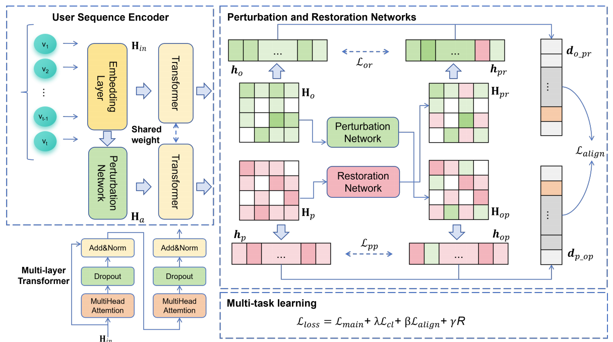

# ACLSRec

This is our Pytorch implementation for the paper: "**[Adaptive Contrastive Learning in Sequential Recommendation based on Perturbation and Restoration Networks](https://doi.org/10.1145/nnnnnnn.nnnnnnn)**" (WWW 2026).

## Environment Requirement

* Pytorch>=1.10.0
* Python>=3.8
* RecBole>=1.1.1

## Model Overview



## Usage

Please run the following command to install all the requirements:  

```bash
pip install -r requirements.txt
```
```
$ tree
.
├── Amazon_Beauty
│   ├── Amazon_Beauty.inter
│   └── Amazon_Beauty.item
├── Amazon_Clothing_Shoes_and_Jewelry
│   ├── Amazon_Clothing_Shoes_and_Jewelry.inter
│   └── Amazon_Clothing_Shoes_and_Jewelry.item
├── Amazon_Sports_and_Outdoors
│   ├── Amazon_Sports_and_Outdoors.inter
│   └── Amazon_Sports_and_Outdoors.item
├── ml-1m
│   ├── ml-1m.inter
│   ├── ml-1m.item
│   ├── ml-1m.user
│   └── README.md
└── yelp
    ├── README.md
    ├── yelp.inter
    ├── yelp.item
    └── yelp.user

```

## Evaluate Model

We provide the implementation based on RecBole. You can directly evaluate the models on the test set.

```python
python run_aclsrec.py --dataset=Amazon_Beauty --lmd=0.1 --sim_lambda=100.0 --gamma=0.01 --tau=1 --model=ACLSRec
```

## Acknowledgment

- Transformer and training pipeline are implemented based on [Recbole](https://github.com/RUCAIBox/RecBole). Thanks them for providing efficient implementation.

## Citation
```
@inproceedings{ACLSRec,
  author    = {Yanbo Zhou and
               Bin Lü and
               Xu-Hua Yang and
               Xin-Li Xu and
               Boling Wang},
  title     = {Adaptive Contrastive Learning in Sequential Recommendation based on Perturbation and Restoration Networks},
  booktitle = {Proceedings of the ACM Conference},
  year      = {2026},
  publisher = {WWW},
  address   = {Zhejiang University of Technology}
}
```
- Please kindly cite our paper if this paper and the code are helpful.
